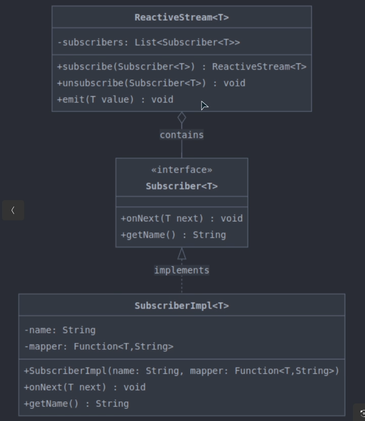

## Arquitectura de un sistema de suscripción y observación de flujos de datos.

Aqui se puede ver un ejemplo de un sistema de suscripción y observación de flujos de datos. En este sistema, los suscriptores pueden registrarse para recibir actualizaciones de un flujo de datos específico. Cuando el flujo de datos cambia, los suscriptores son notificados y pueden reaccionar en consecuencia.
